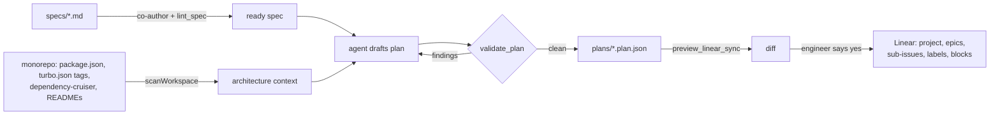

# spec-to-linear

An agentic workflow that co-authors feature specs with your team, breaks them into well-scoped tickets, checks those tickets against your monorepo's architecture, and writes them to Linear as a project with epics, sub-issues, labels, estimates and blocking relations.

It runs inside **Cursor** and **Claude Code** through an MCP server, or headless from a CLI (useful in CI).



The LLM drafts the plan and plain TypeScript decides whether it ships. The agent can slice the work however it wants, but a plan that imports across a forbidden boundary, has a dependency cycle, touches a package before the ticket that creates it, or carries an unsplittable 13-point ticket never reaches Linear.

## Try it in two minutes

```bash
pnpm install
pnpm check                                   # typecheck, dependency-cruiser, 22 Vitest tests

export STL_ROOT=examples/acme                # a small fake monorepo shaped like a real one
pnpm stl context                             # what the agent knows about the codebase
pnpm stl spec lint examples/acme/specs/tenant-audit-log.md
pnpm stl validate examples/acme/plans/tenant-audit-log.plan.json
pnpm stl sync examples/acme/plans/tenant-audit-log.plan.json --offline   # dry run against an in-memory Linear
```

To write to a real Linear workspace, put `LINEAR_API_KEY` and `LINEAR_TEAM_KEY` in `.env`, then:

```bash
pnpm stl sync examples/acme/plans/tenant-audit-log.plan.json            # diff only
pnpm stl sync examples/acme/plans/tenant-audit-log.plan.json --apply    # create and update
```

Run `--apply` twice and the second run makes zero writes.

## In Cursor or Claude Code

Open the repo. The MCP server is registered in `.cursor/mcp.json` and `.mcp.json`. Then ask the agent things like:

- "Let's spec out SSO for tenants." It follows `.cursor/rules/spec-coauthoring.mdc` (Claude Code: skill `spec-coauthor`): reads the architecture, asks the questions a senior reviewer would ask section by section, keeps unresolved items as open questions, and stops when `lint_spec` passes.
- "Break the invite expiry spec into tickets and put them in Linear." It follows `.cursor/rules/spec-to-tickets.mdc` (skill `spec-to-tickets`): drafts the plan, loops on `validate_plan` until clean, shows you the tree, saves it, shows the Linear diff, and applies only after you say yes.

None of the MCP tools call an LLM. The IDE agent does the thinking, the server gives it the codebase context and the checks, and you do not need a model API key inside the IDE.

MCP tools: `get_architecture_context`, `new_spec`, `lint_spec`, `validate_plan`, `save_plan`, `preview_linear_sync`, `apply_linear_sync`.

**Recorded run:** [docs/runs/invite-expiry.md](docs/runs/invite-expiry.md) is a real session of Claude Code driving the server on `specs/invite-expiry.md`. The first draft sent the portal's settings page straight to the database package, the validator rejected it under `apps-no-direct-db`, and the agent rerouted it through a feature package before saving.

## Headless

The same loop through the Claude API, for CI or batch use:

```bash
ANTHROPIC_API_KEY=... pnpm stl spec review examples/acme/specs/tenant-sso.md   # blocking questions, packages, boundary risks
ANTHROPIC_API_KEY=... pnpm stl plan examples/acme/specs/invite-expiry.md       # decompose with up to 3 repair rounds
```

`stl plan` uses structured outputs with a JSON schema generated from the same Effect Schema the validators use, caches the architecture context across repair rounds, and feeds validator findings back to the model as repair instructions (`packages/planner/src/decompose.ts`).

## What the validator checks

| Check                                                                                     | Why                                                    |
| ----------------------------------------------------------------------------------------- | ------------------------------------------------------ |
| Every new import edge against Turborepo boundaries tags and dependency-cruiser path rules | Tickets that cannot pass CI should not exist           |
| Rules also apply to packages the plan creates (by their declared path and tags)           | New packages are where boundaries usually slip         |
| A ticket touching a new package depends on the ticket that creates it                     | Nobody starts work on a folder that does not exist yet |
| No dependency cycles, no unknown keys, unique keys                                        | Linear "blocks" relations stay meaningful              |
| Estimates on 1, 2, 3, 5, 8; above 8 must be split                                         | One ticket, one reviewable PR                          |
| At least two acceptance criteria, vague ones flagged ("works correctly")                  | Criteria a reviewer can actually check                 |
| More than two packages in one ticket is a warning                                         | Wide tickets are slow to review                        |
| Spec lint: all template sections filled, no unchecked open questions                      | No decomposition on top of undecided scope             |

## How it lands in Linear

| Plan                | Linear                                                                        |
| ------------------- | ----------------------------------------------------------------------------- |
| spec                | Project (description capped at 255 chars, full text in content)               |
| epic                | Parent issue with label `epic`                                                |
| ticket              | Sub-issue of its epic, estimate, labels `<type>`, `spec:<id>` and custom ones |
| `dependsOn`         | "blocks" relation from the dependency to the ticket                           |
| acceptance criteria | Checklist in the description                                                  |

There is no local state file. Every issue carries `stl:<spec>/<key> · rev <hash>` in its description. A re-run finds issues by that marker and compares the hash of the body it would send, so Linear reformatting the markdown on save does not show up as a change. Tickets dropped from the plan are reported, never deleted. Teams with estimates turned off get none sent.

## Layout

```
packages/core       plan schema (Effect Schema), validators, spec template and lint, rendering. No IO.
packages/context    scans the monorepo: workspaces, turbo tags and boundaries, dependency-cruiser rules, READMEs
packages/planner    Claude API model layer, spec review, decomposition with the repair loop
packages/linear     LinearApi service (GraphQL live layer + in-memory layer), idempotent sync
apps/cli            `stl` command
apps/mcp            MCP server for Cursor and Claude Code
examples/acme       fake monorepo: 5 Next.js apps, 11 packages, layer tags, boundary rules, three specs (one still a draft) and two plans
.cursor/rules, .claude/skills, AGENTS.md   the agent procedures
```

The repo keeps its own boundaries: `core` imports nothing internal, the three libraries depend only on `core`, and only apps compose them (`.dependency-cruiser.cjs`, checked in CI).

## Adapting it to your monorepo

1. Point `STL_ROOT` at the repo root. The scanner reads `pnpm-workspace.yaml` or `workspaces`, each package's `turbo.json` tags and README, root `turbo.json` boundaries and `.dependency-cruiser.cjs`.
2. Put architecture notes in `docs/architecture.md`. They go to the agent verbatim; this is where conventions like "every service is a `Context.Tag` with a test Layer" live.
3. Adjust the spec template (`packages/core/src/spec.ts`) and the estimate scale and limits (`packages/core/src/validate.ts`) to how your team works.
4. Add validators for your own rules. Each one is a function from plan and context to findings, with a message written to be pasted back to the model.

## Stack

TypeScript, Effect (Schema, services and layers, tagged errors), pnpm workspaces with Turborepo, Vitest, dependency-cruiser, MCP TypeScript SDK, Anthropic TypeScript SDK, Linear GraphQL API.

MIT licensed. Built by [Alpina Tech](https://github.com/engineering-alpina).
